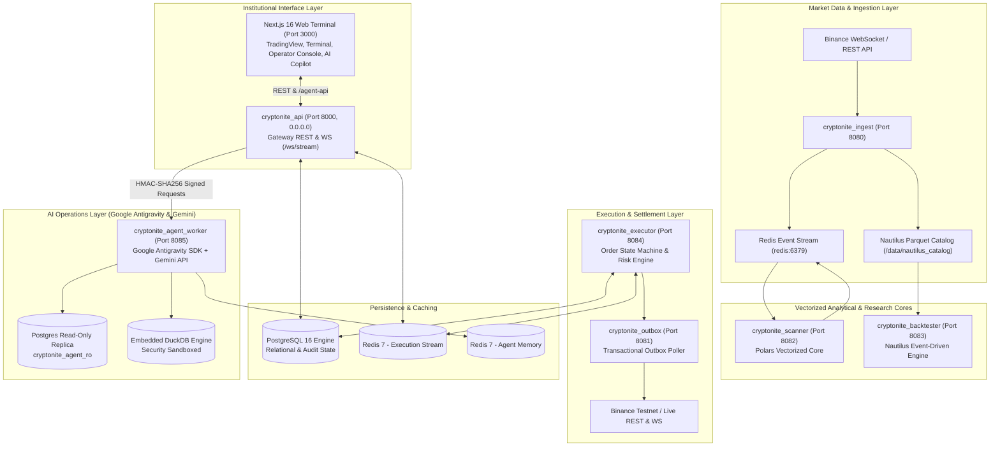
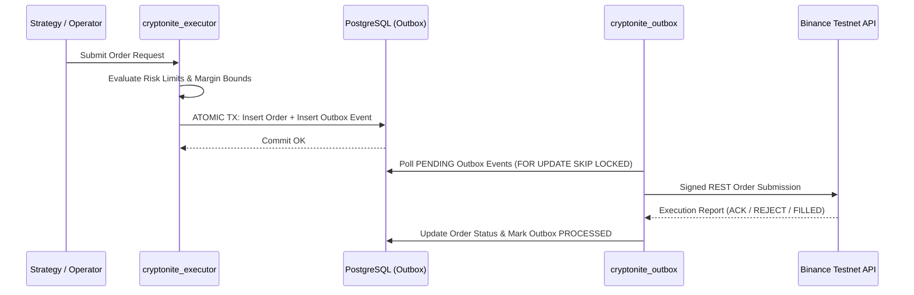

# Cryptonite

Cryptonite is an institutional-grade, low-latency cryptocurrency algorithmic trading workstation. It unites tick/candle streaming, high-frequency technical screener calculations, discrete-event backtesting, and full operator trade governance within a modern single-pane dashboard.

It is a self-hosted cryptocurrency intelligence and algorithmic trading platform designed for auditable research, deterministic risk controls, and automated execution with NautilusTrader.

## Platform Screenshots

| Trading Terminal | AI Copilot |
| :---: | :---: |
|  |  |

| Research Lab | Portfolio Console |
| :---: | :---: |
|  |  |

## Architecture Core Principles
- **AI and UI can propose.**
- **Deterministic rules and risk controls decide.**
- **NautilusTrader executes.**

## System Architecture



## Project Structure
```
cryptonite/
├── apps/
│   └── web/             # Next.js 14 Institutional Web Terminal UI
├── docs/                # Architecture specifications & data contracts
├── infra/               # Docker Compose, Dockerfiles, and Alembic migrations
├── packages/
│   ├── schemas/         # Shared domain models and abstract source interfaces
│   ├── storage/         # Nautilus ParquetDataCatalog and Enriched Analytics Lake
│   ├── execution/       # Order State Machine and Risk Constraints
│   ├── backtester/      # Nautilus Backtesting Engine wrapper
│   ├── strategies/      # Base implementations of Quantitative Strategies
│   └── agents/          # Antigravity SDK & Gemini Agent Multi-Agent Fleet
└── services/
    ├── api/             # FastAPI Gateway, REST, WebSocket & Background Alerts
    ├── ingest/          # Binance WebSocket stream, REST recovery recorder, and On-Chain RPC
    ├── scanner/         # Polars Vectorized Screening Engine
    ├── debate_worker/   # AI Adversarial Debate Engine (TradingAgents integration)
    └── outbox/          # Transactional Outbox Poller & Binance Execution Bridge
```

## Quick Start
```bash
# 1. Start local PostgreSQL
docker compose -f infra/docker-compose.yml up -d postgres

# 2. Run migrations
uv run alembic -c infra/migrations/alembic.ini upgrade head

# 3. Run test suite
uv run pytest
```

## Multi-Agent Debate Engine
Cryptonite integrates an advanced adversarial AI pipeline powered by the Google Antigravity SDK and Gemini Flash/Pro:
- **Analyst Fleet:** Market, Sentiment, and On-Chain agents autonomously gather real-time data and generate intelligence dossiers.
- **Adversarial Debate:** A Bull Researcher and a Bear Researcher aggressively debate the dossier to expose weaknesses in the trade thesis.
- **Portfolio & Risk Managers:** A Portfolio Manager proxy sets an initial allocation, followed by a 3-persona Risk Debate (Aggressive, Conservative, Neutral). The Chief Risk Officer synthesizes the final conviction level (e.g. `OVERWEIGHT` / `HOLD`).
- **Reflection Engine:** Completed trades are joined with DuckDB time-series data to calculate *Alpha*. The AI distills 'Lessons Learned' which are dynamically injected into future debates, allowing the system to self-correct over time without code changes.
- **Safety First:** AI agents operate through an Anti-Corruption Layer with strictly read-only, anonymized database access, hard limits on concentration (25.0%), and hardware-level kill-switches.

## Perpetual Futures (Paper Trading)

BTCUSDT / ETHUSDT USD-M perpetuals run on the paper engine alongside spot: 1–20× leverage, isolated or cross margin, shorts, reduce-only, exact Binance-tiered liquidation prices, synthetic liquidations, and funding settlement. Risk invariants: entry notional ≥ 1% and position notional ≤ 25% of equity, mark price ≤ 10 s old, 5% daily drawdown circuit breaker (resets at 00:00 UTC), and a PAPER kill switch that still lets reduce-only exits through. Market data comes from Binance `fstream` (`/market` for marks, `/public` for book tickers, coalesced to 50 Hz). The terminal's **Trade** sidebar has the order ticket, margin risk HUD, and PAPER kill switch.

- Architecture: [docs/perpetuals-architecture.md](docs/perpetuals-architecture.md) · design decisions: [docs/perpetuals-phase1-blueprint.md](docs/perpetuals-phase1-blueprint.md) · operating limits: [HANDOFF.md](HANDOFF.md)
- Run: `docker compose -f infra/docker-compose.yml up -d postgres redis ingest derivatives_feed orchestrator api`, then `cd apps/web && pnpm dev` and open `http://localhost:3000`

## Transactional Outbox Execution Pipeline
To ensure high availability and prevent dual-write hazards during network partitions, execution logic uses the transactional outbox pattern.


