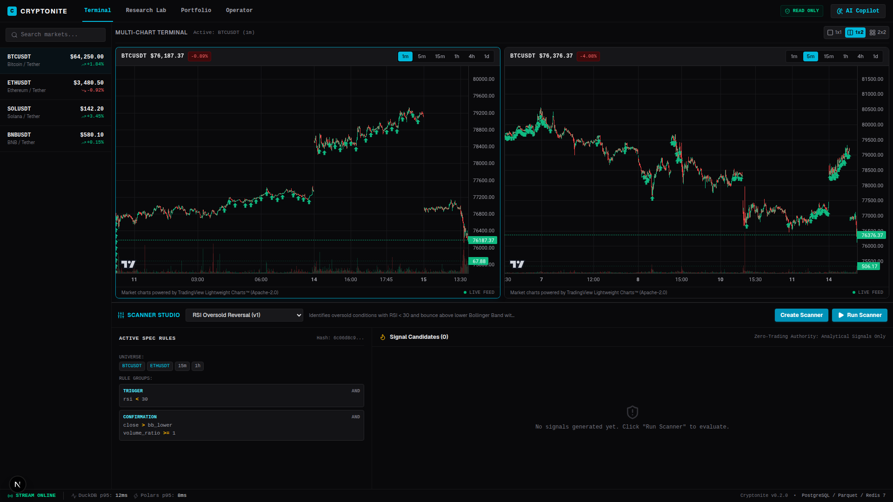
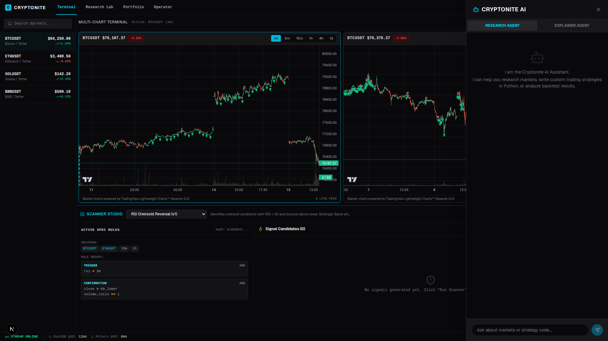
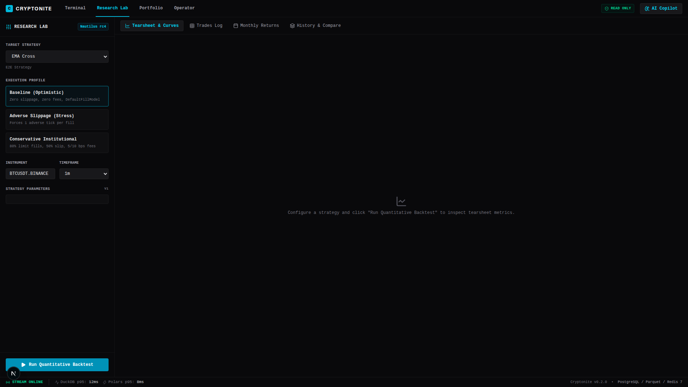
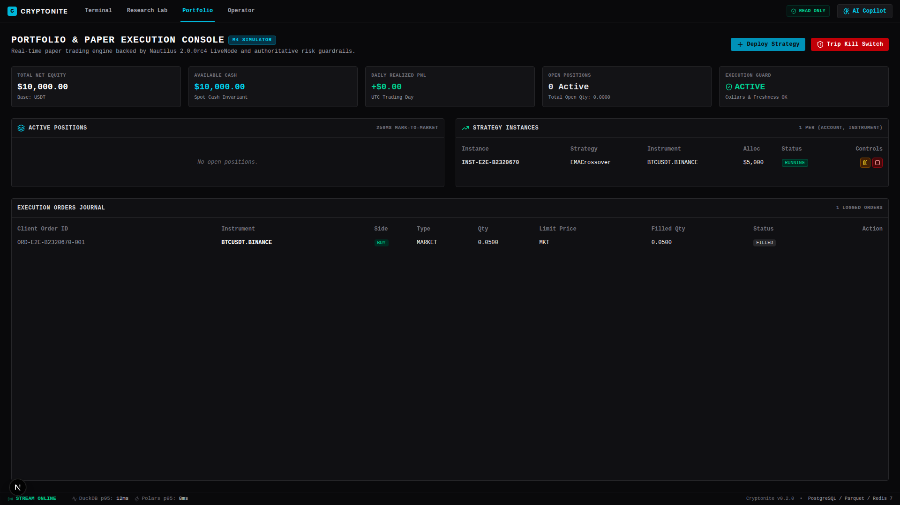
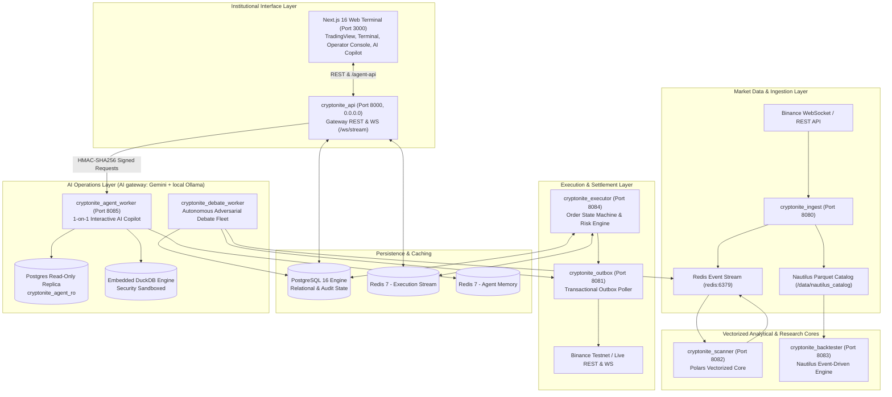
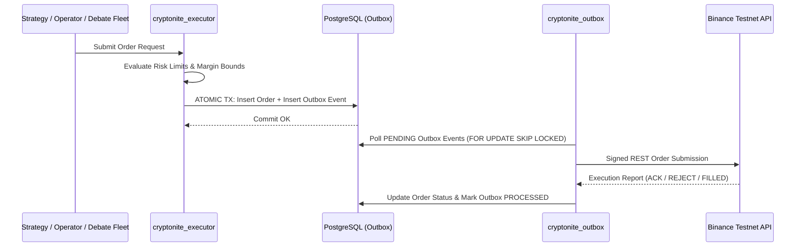

# Cryptonite

Cryptonite is an institutional-grade, low-latency cryptocurrency algorithmic trading workstation. It unites tick/candle streaming, high-frequency technical screener calculations, discrete-event backtesting, and full operator trade governance within a modern single-pane dashboard.

It is a self-hosted cryptocurrency intelligence and algorithmic trading platform designed for auditable research, deterministic risk controls, and automated execution with NautilusTrader.

## Current state (2026-10-04)

The **AI-First program** (Phases 0–7) is built on branch `feat/ai-first-phase6`: one AI gateway with a
local model tier (Gemma 4 12B on Ollama for triage and summaries), trading **mandates** with autonomy
levels and Telegram approvals, a news-sentiment service, an outcome-labelling learner, and a strategy
research loop. What runs and how: [docs/ai-first-program.md](docs/ai-first-program.md). Current status and
open items: [HANDOFF.md](HANDOFF.md).

**No AI order executes without an active mandate**, and every order still passes `GuardedOrderDispatcher`
(1–25% equity clamp).

## Platform Screenshots

| Trading Terminal | AI Copilot |
| :---: | :---: |
|  |  |

| Research Lab | Portfolio Console |
| :---: | :---: |
|  |  |

## Architecture Core Principles
- **AI and UI can propose.**
- **Deterministic rules and risk controls decide.**
- **NautilusTrader executes.**
- **Spot Trading Native:** Fully integrated pipeline for Spot markets (Futures routing is supported in the execution adapter, but ingestion/onboarding pipelines currently track Spot pairs exclusively).

## System Architecture



## Project Structure
```
cryptonite/
├── apps/
│   └── web/             # Next.js 16 (React 19) Institutional Web Terminal UI
├── docs/                # Architecture specifications & data contracts
├── infra/               # Docker Compose, Dockerfiles, and Alembic migrations
├── packages/
│   ├── schemas/         # Shared domain models and abstract source interfaces
│   ├── storage/         # Nautilus ParquetDataCatalog and Enriched Analytics Lake
│   ├── execution/       # Order State Machine and Risk Constraints
│   ├── backtester/      # Nautilus Backtesting Engine wrapper
│   ├── strategies/      # Base implementations of Quantitative Strategies
│   └── agents/          # AI gateway (Pydantic AI; Gemini + local Ollama), tools, debate fleet, evals
└── services/
    ├── api/             # FastAPI Gateway, REST, WebSocket & Background Alerts
    ├── ingest/          # Binance WebSocket stream, REST recovery recorder, and On-Chain RPC
    ├── scanner/         # Polars Vectorized Screening Engine & Exit Surveillance
    ├── debate_worker/   # Pre-debate gate, triage, debate engine; also runs the learner
    ├── agent_worker/    # Brain copilot and chat personas (through the AI gateway)
    ├── orchestrator/    # Paper engine, mandate risk monitor, approval sweeper, autonomy gates
    ├── notifier/        # Telegram approvals (TOTP) and ntfy Critical alerts
    ├── sentiment/       # FinBERT news sentiment on CPU (internal network only)
    └── outbox/          # Transactional Outbox Poller & Binance Execution Bridge
```

## Quick Start

Secrets live in a git-ignored `.env` at the repo root (`infra/.env` is a symlink to it, so Compose reads
it). Redis requires `REDIS_PASSWORD` from that file.

```bash
# 1. Start Postgres and Redis
docker compose -f infra/docker-compose.yml up -d postgres redis

# 2. Run migrations (through the test image, which has Alembic)
docker compose -f infra/docker-compose.yml run --rm test uv run python -m alembic -c infra/migrations/alembic.ini upgrade head

# 3. Start the stack (add --profile monitoring for the exit monitor, --profile notifier for Telegram)
docker compose -f infra/docker-compose.yml --profile monitoring up -d

# 4. Web
cd apps/web && pnpm install && pnpm dev   # http://localhost:3000
```

Run the test suite against a throwaway database, never the dev DB (one test downgrades the schema to
`base`); the exact command is in [HANDOFF.md](HANDOFF.md). The local model tier (Ollama on the host) is
described in [docs/runbooks/local_ai_tier.md](docs/runbooks/local_ai_tier.md).

## Institutional Web Terminal UI & Workstation
Cryptonite features a high-density, Bloomberg-style trading workstation:
- **Modular 3-Column Layout**: Collapsible sidebars with quick toggles for **Watchlist**, **Orderbook**, and **AI Debate** with real-time mode indicators (`Full Canvas`, `2-Column`, `3-Column`) that persist across browser sessions.
- **Real-Time Orderbook L2 Depth**: Live mid-market price anchoring, dynamic depth volume bars (green/red), instant spread calculation, and customizable tick grouping (`0.1`, `1`, `10` USDT). Fully hydration-safe SSR.
- **Precision Floating AI Copilot**: 8-direction resizable floating window (`n`, `s`, `e`, `w`, `ne`, `nw`, `se`, `sw`) with viewport clamping, header dragging, a 1-click **Center Window** button, 5 isolated persona conversation threads, native text selection, and 1-click transcript export.
- **Interactive Execution Staging Canvas**: Live decision price drift telemetry, risk limit overrides (0.5% - 25.0% allocation slider, Market/Limit order types), and a high-assurance **2-second hold-to-approve** safety mechanism.

## Multi-Agent Operations: Copilot vs. Debate Fleet
Cryptonite separates AI operations into two distinct, specialized operational layers:
1. **Interactive AI Copilot (`cryptonite_agent_worker:8085`)**: Direct 1-on-1 dialogue with 5 specialized personas (**Research Intelligence**, **Execution Strategist**, **Backtest Explainer**, **Chief Risk Officer**, **On-Chain Intelligence**) maintaining isolated thread histories and un-sent draft states.
2. **Autonomous Adversarial Debate Fleet (`cryptonite_debate_worker`)**: Background consensus pipeline combining:
   - **Analyst Fleet:** Market, Sentiment, and On-Chain agents autonomously gather real-time data and generate intelligence dossiers.
   - **Adversarial Debate:** A Bull Researcher and a Bear Researcher aggressively debate the dossier to expose weaknesses in the trade thesis.
   - **Portfolio & Risk Managers:** A Portfolio Manager proxy sets an initial allocation, followed by a 3-persona Risk Debate (Aggressive, Conservative, Neutral). The Chief Risk Officer synthesizes the final conviction level (e.g. `OVERWEIGHT` / `HOLD`).
   - **Learning loop:** the learner labels every debate decision at 1h/4h/24h/72h from the analytics lake, writes a reflection from the 24h outcome with alpha against BTC, and embeds it locally (`embeddinggemma`, `vector(768)`, model recorded per row). Future debates recall the same-model lessons ranked by outcome. Verdict confidence is calibrated (ECE) and feeds the autonomy gate.
   - **Safety First:** AI agents operate through an Anti-Corruption Layer with strictly read-only, anonymized database access, hard limits on concentration (25.0%), and hardware-level kill-switches.

## Perpetual Futures (Paper Trading)

BTCUSDT / ETHUSDT USD-M perpetuals run on the paper engine alongside spot: 1–20× leverage, isolated or cross margin, shorts, reduce-only, exact Binance-tiered liquidation prices, synthetic liquidations, and funding settlement. Risk invariants: entry notional ≥ 1% and position notional ≤ 25% of equity, mark price ≤ 10 s old, 5% daily drawdown circuit breaker (resets at 00:00 UTC), and a PAPER kill switch that still lets reduce-only exits through. Market data comes from Binance `fstream` (`/market` for marks, `/public` for book tickers, coalesced to 50 Hz). The terminal's **Trade** sidebar has the order ticket, margin risk HUD, and PAPER kill switch.

- Architecture: [docs/perpetuals-architecture.md](docs/perpetuals-architecture.md) · design decisions: [docs/perpetuals-phase1-blueprint.md](docs/perpetuals-phase1-blueprint.md) · operating limits: [HANDOFF.md](HANDOFF.md)
- Run: `docker compose -f infra/docker-compose.yml up -d postgres redis ingest derivatives_feed orchestrator api`, then `cd apps/web && pnpm dev` and open `http://localhost:3000`

## Transactional Outbox Execution Pipeline
To ensure high availability and prevent dual-write hazards during network partitions, execution logic uses the transactional outbox pattern.



### Recent Updates (v0.4.5 - Operator Governance & Action Inbox Architecture)
- **Database-Backed Action & Decision Inbox**: Refactored the Action Inbox to hydrate directly from PostgreSQL (`GET /api/v1/agents/debates`), with automatic client-side cache reconciliation that purges local browser storage when database records are cleared. Added formatted timestamps and strict chronological sorting.
- **Docked Operator Control Sidebar**: Added direct access to the Execution Kill-Switch panel from the main Trading Terminal via the right-sidebar toolbar (red Shield toggle), allowing traders to manage risk and trip emergency stops without leaving active charts.
- **Industrial Kill-Switch Redesign**: Completely overhauled `KillSwitchPanel.tsx` with physical control-room styling, dynamic ambient glows (Emerald Armed vs. Pulsing Hazard Rose Latched), and generation-based latch verification.
- **Backend Authentication Hardening**: Fixed machine token type inference bug in `routes/auth.py` with Python `hashlib.sha256` pre-hashing, eliminating intermittent 500 errors during high-frequency telemetry polling.
- **Paper Trading Reset & Balance Seeding**: Cleaned demo/test ledgers while preserving core system execution vehicles (`AI_DEBATE_WORKER`, `MANUAL_TRADE`), and seeded $100,000 USDT paper balances across DEMO and PAPER environments.

### Previous Updates (v0.4.0 - Alpha Lifecycle Integration)
- **Unified Alpha Lifecycle Integration**: Transformed Copilot, Research Lab, and the AI Brain Workspace into an interconnected quantitative loop with 1-click workflow bridges.
- **AI Brain Orchestrator & Inline Action Cards**: `OrchestratorCanvas` automatically intercepts strategy manifests and renders interactive `<InlineActionCard>` blocks with 1-click **[🧪 Backtest in Lab]** (auto-prefilling Nautilus parameters), **[⚔️ Trigger Debate]**, and **[📥 Stage to Inbox]**.
- **Interactive Risk Allocation Sliders**: Embedded inline allocation sizing strictly clamped to the institutional 25.0% max portfolio equity ceiling ($25k max on $100k account).
- **Live Redis Telemetry Stream**: Replaced mock thought latencies with real-time WebSocket subscriptions to Redis `HEARTBEAT` streams, rendering live sub-agent status traces during query execution.
- **Dynamic Context Tags & System Prompts**: Added `@Backtest(latest)` and `/delta @PaperPosition(latest)` quick tags on the input rail that inject invisible system directives for `read_nautilus_tearsheet` and `compare_live_vs_backtest`.
- **Live vs. Backtest Delta Diagnostic Tool**: Built `compare_live_vs_backtest` to compare live PostgreSQL fills (`agent_safe_orders`) against Nautilus historical Parquet trades (`trades.parquet`), diagnosing slippage and Sharpe degradation.
- **Engine & RBAC Hardening**:
  - Replaced pandas-dependent DuckDB queries with `.fetchall()`, removing heavy dataframe runtime dependencies.
  - Added `export async function GET` proxy to `/agent-api/[...slug]/route.ts` for bidirectional state syncing.
  - Corrected debate staging quantity math in `approve_debate` to derive exact base asset quantity from live equity and real-time market prices: `quantity = (equity * allocation_pct / 100) / price`.
  - Added `stage_debate_proposal` tool allowing read-only agent sessions (`cryptonite_agent_ro`) to safely stage proposals via the API gateway.

### Previous Updates (v0.3.0)
- **End-to-End AI Execution Pipeline**: Connected the AI Debate Engine directly to the `cryptonite_executor` via the transactional outbox (`execution_commands`). Autonomous mode now fully executes orders without operator intervention within strict risk bounds. *(Superseded: autonomous mode was frozen in Phase 0 and replaced by mandates and autonomy levels in Phase 5.)*
- **Interactive Execution Staging & Safety**: Added the Execution Staging Canvas featuring 2-second hold-to-approve mechanics, parameter overrides, and live price drift monitoring.
- **Modular Bloomberg-Style Terminal & Orderbook L2**: Added 3-column layout controls, dynamic depth bars, and 8-direction floating Copilot with zero hydration mismatches.
- **Reflection Engine & Vector Recall**: Added pgvector 768-dimensional embeddings for historical trade reflections, enabling continuous self-improvement across changing volatility regimes.
- **Telemetry & Parquet Enhancements**: Resolved DuckDB cross-schema compatibility issues between Nautilus Parquet catalogs (`ts_init_ns`/`ts_event_ns`) and Polars resamplers (`bar_open_ns`), ensuring real-time charting and AI vector queries are 100% consistent.
