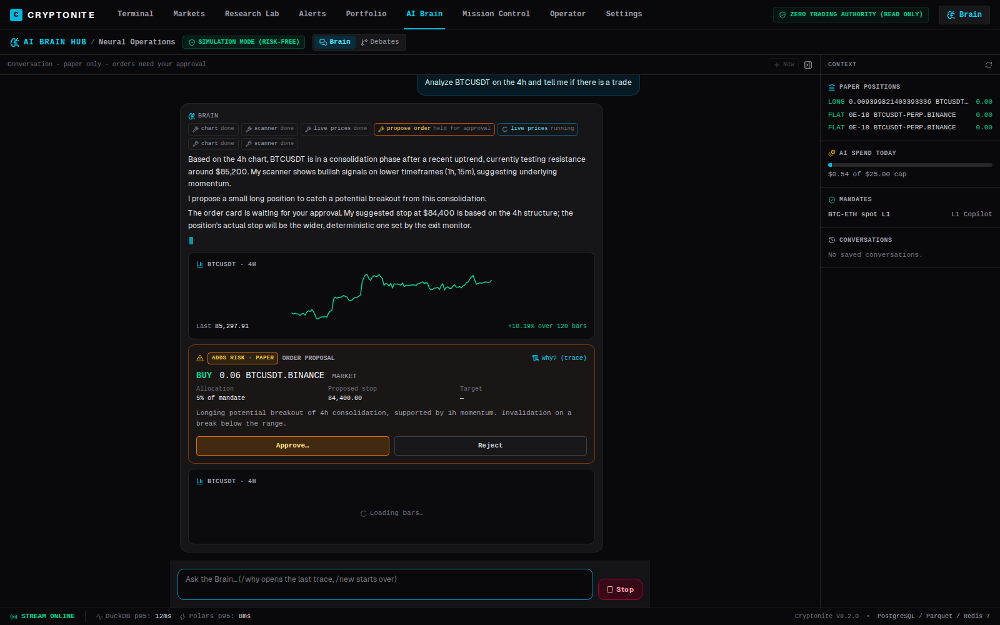
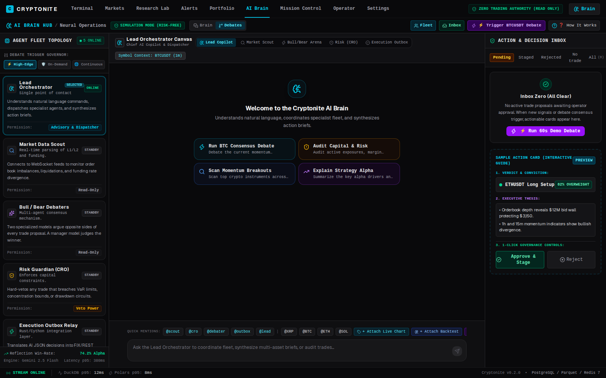
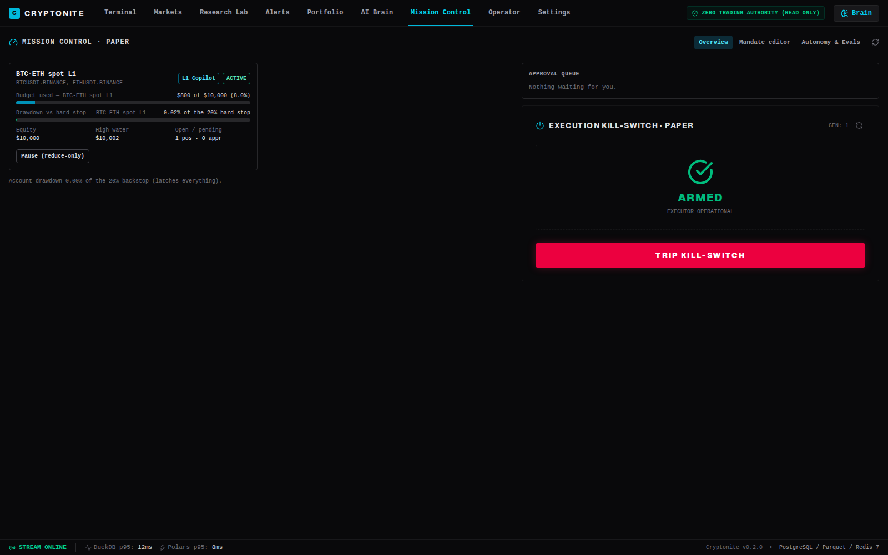
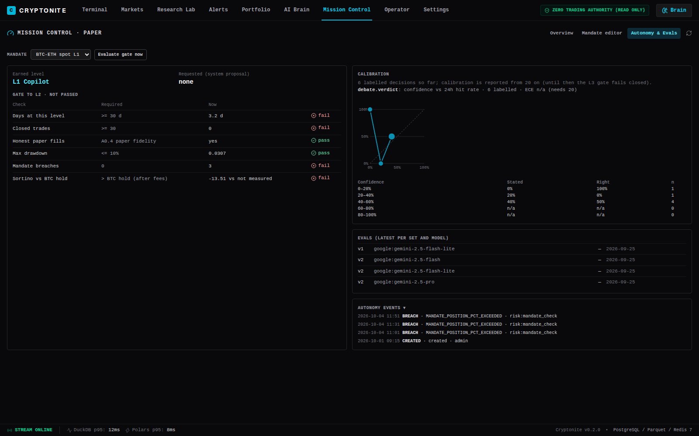
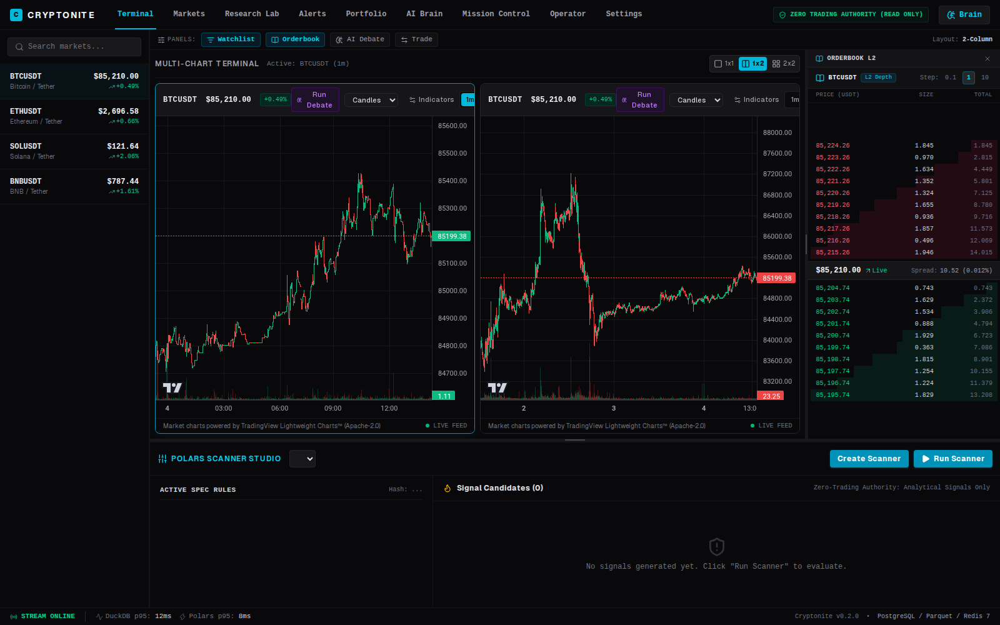
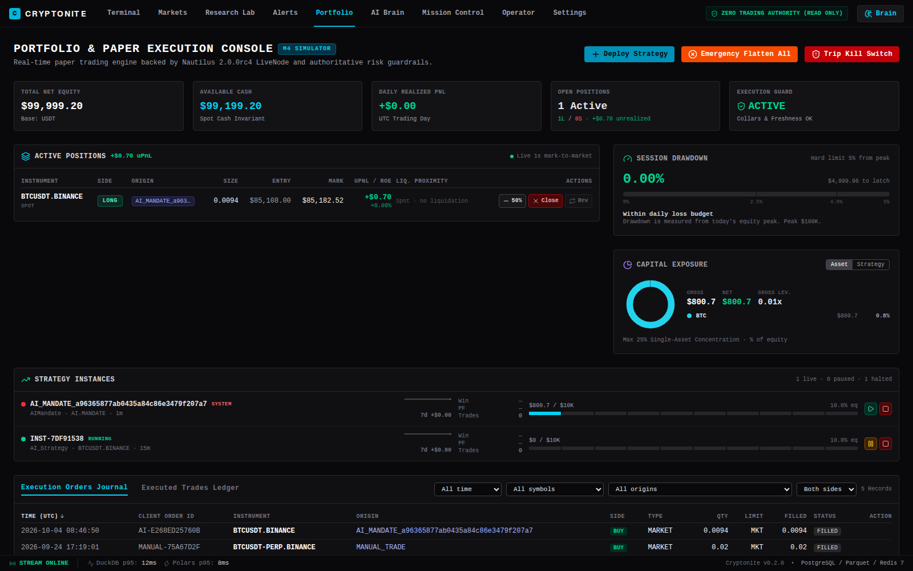
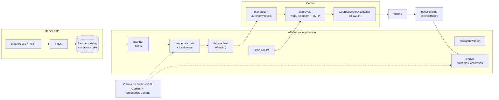

# Cryptonite

**A self-hosted crypto trading workstation where a team of AI agents researches, debates and proposes
trades, and deterministic risk controls decide what is allowed to happen.**

Cryptonite combines live market data, a vectorized scanner, NautilusTrader backtesting and paper
execution with an AI layer: a copilot you can talk to, a debate fleet that argues every trade, a
research loop that writes and tests strategies, and a learner that grades past decisions against what
the market actually did. The AI can only act inside **mandates** you define (budget, instruments,
position limit, hard stop), at an **autonomy level** it has to earn, and every risk-adding order waits
for your approval, in the web app or on Telegram with a one-time code.

> **Paper and testnet only.** Cryptonite trades a paper account and the Binance demo environment. It is
> research software, not investment advice.



## The agents in action

| Brain copilot | Agent fleet |
| :---: | :---: |
|  |  |
| Ask in plain language. The Brain calls tools (charts, scanner, live prices, backtests), answers with widgets, and can only **propose** an order card that you approve or reject. | The debate fleet: analysts gather market, news-sentiment and on-chain context, bull and bear researchers argue, and a risk panel and chief risk officer set the verdict and size. |
| **Mission Control** | **Autonomy & evals** |
|  |  |
| Mandates with budget used and drawdown against the hard stop, the approval queue, and the PAPER kill switch. | The gate a mandate must pass to move up a level, how well the debate's confidence matches outcomes (calibration), and every breach, promotion and demotion. |
| **Trading terminal** | **Portfolio & paper execution** |
|  |  |
| Live Binance charts, L2 orderbook, watchlist, the Polars scanner, and a **Run Debate** button on every chart. | Paper positions per mandate, session drawdown, exposure, strategy instances and the full order journal. |

## What you can use it for

- **Trade with an AI copilot, keep the final say.** Ask "is there a trade on BTC 4h?"; get the analysis,
  the chart and a sized order proposal. Nothing executes until you approve it.
- **Run supervised AI trading on paper.** Give the AI a mandate (for example $10,000, BTC and ETH, 10%
  max position, 20% hard stop). The scanner finds setups, a cheap local model triages them, the debate
  fleet decides, and risk-adding orders come to your phone for approval.
- **Let autonomy be earned, not granted.** Mandates start at L1 Copilot. The system proposes a promotion
  only when the gate passes (days at level, closed trades, no breaches, drawdown, return against holding
  BTC, calibrated confidence), and only you can confirm it. Losses demote automatically.
- **Research strategies with an AI that cannot cheat itself.** Queue an idea; the research worker drafts
  the code, backtests it in a sandbox, tunes parameters on in-sample data only, and rejects anything that
  fails out of sample before it pays for a senior-model review.
- **Screen and watch markets.** Vectorized technical scans, price alerts, and an exit monitor that
  enforces hard and trailing stops on every AI-owned position.
- **Paper-trade perpetual futures.** 1–20× leverage, isolated or cross margin, Binance-tiered liquidation
  prices and funding.
- **Operate the AI like a system.** Every model call goes through one gateway with a daily budget, a
  ledger, decision traces you can open from any answer ("Why?"), evals, and local models on your own GPU.

## How it works

1. **Market data:** Binance WebSocket and REST into a NautilusTrader Parquet catalog and an analytics
   lake (DuckDB / Polars). 120 days of 1m and 1h history are backfilled and gap-checked.
2. **Scanner:** Polars indicator rules find candidates and build a shared **market brief** for each.
3. **Pre-debate gate:** deterministic checks first (kill switch, daily loss, headroom, data freshness,
   cooldown), then a **triage** call on a local model (Gemma 4 12B) decides whether a full debate is
   worth paying for.
4. **Debate:** analysts (market, news sentiment via FinBERT, on-chain), bull vs bear, a risk panel, and a
   verdict from Gemini Pro. Lessons from similar past decisions are recalled by vector search.
5. **Mandate routing:** the verdict goes to the owning mandate's autonomy level: an approval at L1, a
   veto window at L2, direct at L3. No mandate means no order.
6. **Execution:** an approved order is sized against the mandate budget, checked against the mandate,
   then against `GuardedOrderDispatcher` (the non-bypassable 1–25% equity clamp, daily drawdown circuit
   breaker and kill switch), and written through a transactional outbox to the paper engine.
7. **Learning:** the learner labels every decision's outcome at 1h, 4h, 24h and 72h, writes reflections
   from the 24h result, and measures how well verdict confidence matches reality.

The rules that never change: **AI and UI propose. Deterministic rules and risk controls decide.
NautilusTrader executes.**



## Safety model

- **Mandates bound everything the AI does:** instruments, budget, max position (1–25% of the budget),
  hard stop (≤ 20% drawdown), active hours. Breaching half the stop demotes the mandate one level;
  reaching it halts the mandate and closes its own positions; a 20% account loss latches the PAPER kill
  switch and halts every mandate.
- **Approvals are bound to one command** and cannot be replayed. Risk-adding approvals time out to *no*;
  risk-reducing ones time out to *proceed*. Approving risk needs a human operator session and TOTP.
- **The AI cannot write what it reads:** model-callable SQL runs as a read-only role; telemetry, ledger
  and traces are written by a separate role; the backtest worker has its own least-privilege role.
- **Model-written strategy code** runs in an isolated sandbox container (no network, no secrets,
  resource-capped) after an allow-list check.
- **Cost:** a $25/day AI budget with a priority order (exits are never blocked); triage, summaries and
  embeddings run locally for free.
- **Infrastructure:** Redis requires a password, service ports are published on localhost only, and the
  local model server listens on the docker bridge only.

## Tech stack

| Layer | Technology |
|---|---|
| Web | Next.js 16, React 19, TypeScript, Tailwind v4, Zustand, TradingView Lightweight Charts |
| Backend | Python 3.12, FastAPI, asyncpg, uv workspace |
| Trading engine | NautilusTrader 2.0 (backtests, paper execution, Binance demo adapter) |
| Data | PostgreSQL 16 + pgvector, Redis 7, Parquet, DuckDB, Polars |
| AI | Pydantic AI gateway; Google Gemini (Flash-Lite, Flash, Pro); Ollama (Gemma 4 12B, EmbeddingGemma); FinBERT; Unsloth QLoRA for distillation |
| Ops | Docker Compose, Alembic, Playwright, pytest, TruffleHog |

## Project structure

```
cryptonite/
├── apps/web/            # Next.js workstation: terminal, AI Brain, Mission Control, research, portfolio
├── packages/
│   ├── schemas/         # Shared Pydantic contracts (bars, orders, debates, mandates)
│   ├── storage/         # Nautilus catalog and analytics lake
│   ├── scanner/         # Polars indicator engine
│   ├── strategies/      # Strategy base and registry
│   ├── backtester/      # Nautilus runner and the strategy sandbox
│   ├── execution/       # Risk engine, mandates, autonomy ladder, calibration, paper pipeline
│   └── agents/          # AI gateway, tools, Brain, debate fleet, research loop, evals
├── services/
│   ├── api/             # REST + WebSocket gateway
│   ├── ingest/          # Binance market data
│   ├── scanner/         # Candidates, briefs, exit monitor, derivatives feed
│   ├── orchestrator/    # Paper engine, mandate risk monitor, approval sweeper, autonomy gates
│   ├── debate_worker/   # Gate, triage, debates, mandate routing; also runs the learner
│   ├── agent_worker/    # Brain copilot and chat personas
│   ├── notifier/        # Telegram approvals and ntfy alerts
│   ├── sentiment/       # FinBERT news sentiment (CPU)
│   ├── outbox/          # Transactional outbox relay
│   └── executor/        # Binance demo execution (opt-in)
├── infra/               # Docker Compose, Dockerfiles, Alembic migrations
├── scripts/             # Backfills, evals, drills, distillation, gate status
└── docs/                # Architecture, ADRs, runbooks, user manual
```

## Quick start

Requirements: Docker with Compose, Node 22 with pnpm 10, and a Google Gemini API key. A local GPU and
Ollama are optional (without them, local roles fall back to Gemini).

Secrets live in a git-ignored `.env` at the repo root (`infra/.env` is a symlink to it). It needs at
least `GEMINI_API_KEY`, `REDIS_PASSWORD` and `CRYPTONITE_TOTP_AES_KEY` (encrypts TOTP secrets at
rest); Telegram approvals add the notifier keys listed in [HANDOFF.md](HANDOFF.md).

```bash
# 1. Postgres and Redis
docker compose -f infra/docker-compose.yml up -d postgres redis

# 2. Migrations (the test image has Alembic)
docker compose -f infra/docker-compose.yml run --rm test uv run python -m alembic -c infra/migrations/alembic.ini upgrade head

# 3. Create your operator account (prints a TOTP secret for your authenticator app)
docker compose -f infra/docker-compose.yml exec -T api python - <your-username> <your-password> < scripts/create_operator.py

# 4. Start the stack (monitoring = exit monitor, notifier = Telegram)
docker compose -f infra/docker-compose.yml --profile monitoring --profile notifier up -d

# 5. Web
cd apps/web && pnpm install && pnpm dev   # http://localhost:3000
```

Then sign in, open **Mission Control → Mandate editor**, and create your first mandate. Without one, the
AI cannot place any order.

Tests run against a throwaway database (one test downgrades the schema); the command is in
[HANDOFF.md](HANDOFF.md). Local models: [docs/runbooks/local_ai_tier.md](docs/runbooks/local_ai_tier.md).

## Documentation

| Document | What it covers |
|---|---|
| [docs/ai-first-program.md](docs/ai-first-program.md) | The AI layer as built: services, gateway and routes, mandates, approvals, learning, security |
| [docs/USER_MANUAL.md](docs/USER_MANUAL.md) | Using the workstation, including Mission Control and Telegram approvals |
| [ARCHITECTURE.md](ARCHITECTURE.md) | Contracts, schemas, Redis channels, frontend stores |
| [docs/adr/](docs/adr/) | Decisions: provider layer, cost controls, research loop, mandates, local tier |
| [docs/runbooks/](docs/runbooks/) | Kill switch, token rotation, DB bootstrap, local AI tier |
| [docs/perpetuals-architecture.md](docs/perpetuals-architecture.md) | Perpetual futures paper trading |
| [HANDOFF.md](HANDOFF.md) · [AUDIT_STATUS.md](AUDIT_STATUS.md) | Current status, open items, backlog |
| [docs/CHANGELOG.md](docs/CHANGELOG.md) | Release notes from before the AI-First program |

## Status

All AI-First phases (0–7) are on `main`. A mandate is running at L1 on paper; promotion to L2 depends on
30 closed trades and 30 days at the level. A distilled triage model has passed certification and is
waiting for an Ollama upgrade to be deployed. See [HANDOFF.md](HANDOFF.md) for the live state.
