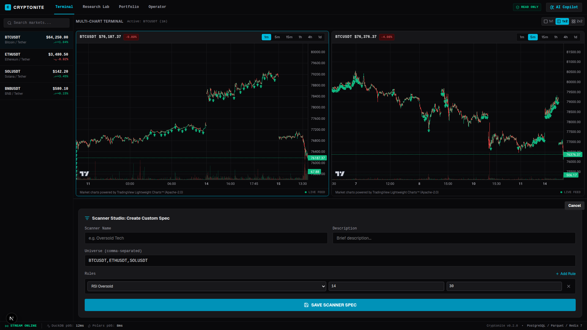
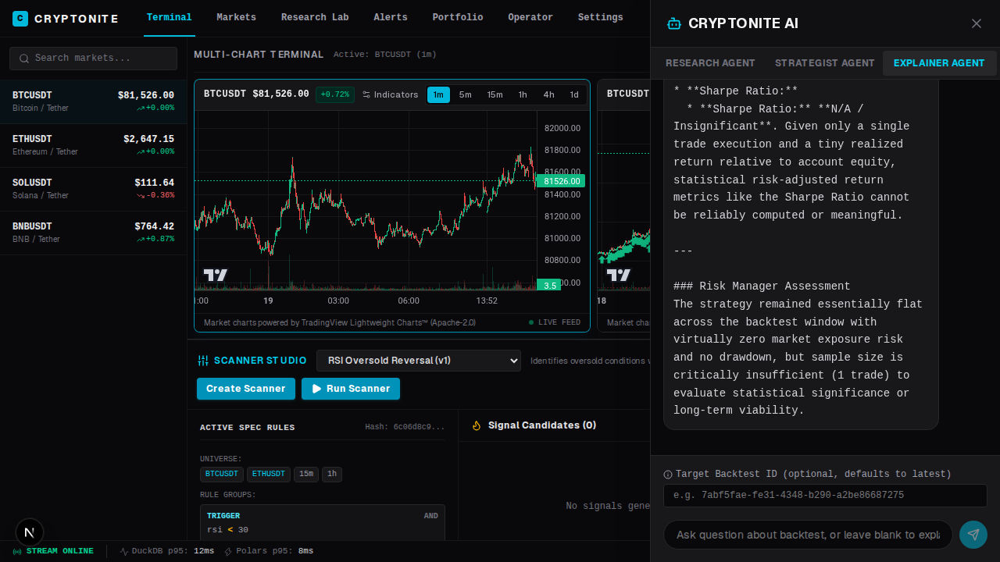
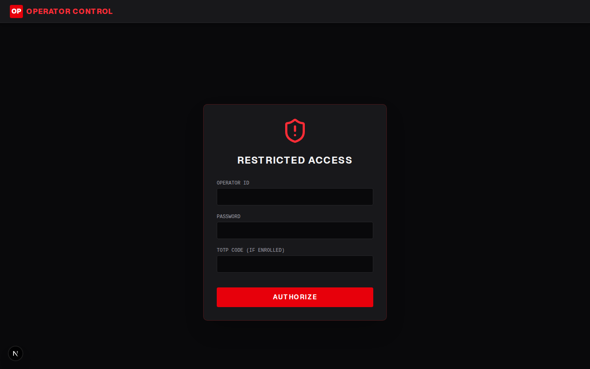
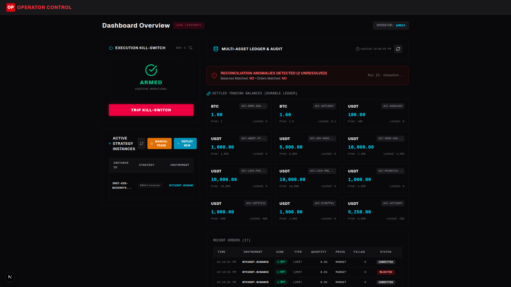
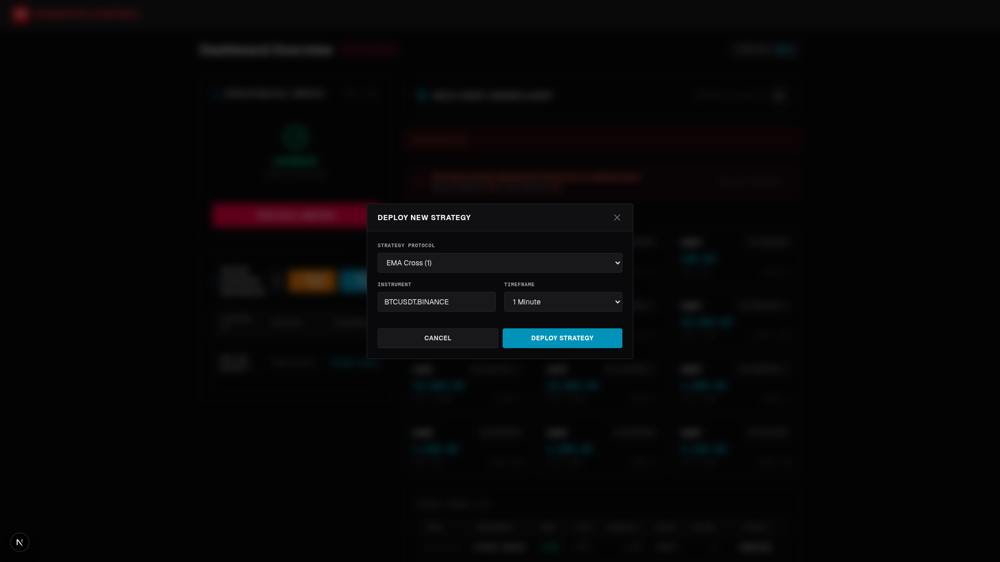
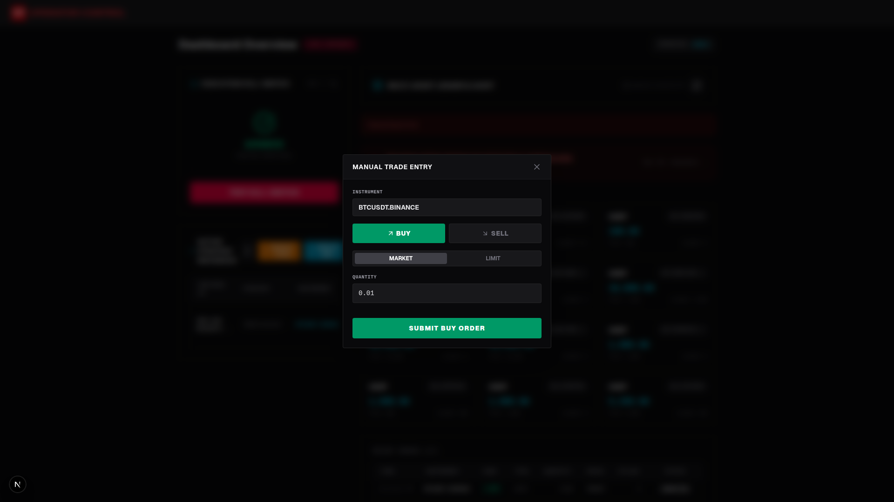

# Cryptonite: Institutional User Manual & Operations Guide
## A Complete Step-by-Step Guide with Live System Walkthroughs

---

## Table of Contents
1. [Welcome & Quick Start Guide](#1-welcome--quick-start-guide)
2. [Trading Terminal & Live Market Data](#2-trading-terminal--live-market-data)
3. [Vectorized Polars Scanner Studio](#3-vectorized-polars-scanner-studio)
4. [Quantitative Research Lab & Backtesting](#4-quantitative-research-lab--backtesting)
5. [Portfolio Console & Risk Analytics](#5-portfolio-console--risk-analytics)
6. [AI Copilot & Multi-Agent Operations](#6-ai-copilot--multi-agent-operations)
7. [Operator Control Plane & Emergency Governance](#7-operator-control-plane--emergency-governance)
8. [Remote LAN & Multi-Device Access Guide](#8-remote-lan--multi-device-access-guide)
9. [Troubleshooting & Frequently Asked Questions](#9-troubleshooting--frequently-asked-questions)
10. [Mission Control: Mandates, Autonomy & Approvals](#10-mission-control-mandates-autonomy--approvals)

---

## 1. Welcome & Quick Start Guide

**Cryptonite** provides quantitative traders, risk officers, and portfolio managers with an integrated workstation for systematic trading.

### 1.1 Service Access Points
* **Web Trading Workstation (Local)**: [http://localhost:3000](http://localhost:3000)
* **Web Trading Workstation (LAN Network)**: [http://192.168.1.203:3000](http://192.168.1.203:3000)
* **Operator Governance Portal**: [http://localhost:3000/operator](http://localhost:3000/operator) or via the **Operator** tab
* **WebSocket Market Stream**: `ws://localhost:8000/ws/stream` (or `ws://192.168.1.203:8000/ws/stream` from LAN)
* **FastAPI Backend Documentation**: [http://localhost:8000/docs](http://localhost:8000/docs)
* **AI Operations Gateway**: [http://localhost:8085/health](http://localhost:8085/health)

### 1.2 Default Operator Credentials
* **Operator ID**: `admin`
* **Master Password**: `admin123`
* **Two-Factor TOTP**: the 6-digit code from your authenticator app (enroll with `scripts/create_operator.py`). The development bypass `000000` works only for login on a dev stack with `ALLOW_DEV_TOTP` enabled, and **never** for AI actions (approvals, mandate changes, promotions).
* **Execution Environment**: Binance Demo / Testnet (Isolated paper risk)

### 1.3 Supported Markets
* **Spot Trading**: Fully supported end-to-end. You can onboard any Binance Spot pair (e.g., `BTCUSDT`, `ETHUSDT`) via the Command Palette to immediately begin streaming live data, generating AI research, and trading.
* **Futures Trading**: *Not currently supported.* While the backend execution engine has the infrastructure to route USD-M Futures, the market data ingestion pipelines currently only track Spot markets.

## 2. Trading Terminal & Live Market Data

The **Trading Terminal** is your primary workspace for active market observation, multi-asset price action, and automated intelligence.


### Key Features & Workflow:
1. **Bloomberg-Style Resizable Workspace**: Features an interactive Lightweight Charts / TradingView multi-chart view, real-time Orderbook depth panel, AI Consensus Debate sidebar, and dockable Operator Control panel.
2. **Panels Quick-Toggles Toolbar**: Use the dedicated top toolbar to toggle the **Watchlist**, **Orderbook**, **AI Debate**, and **Operator Control** (Shield icon) sidebars independently. The mode indicator reflects your active layout state (`Full Canvas`, `2-Column`, or `3-Column`). All toggles persist in `localStorage` across page reloads.
3. **Embedded Operator Emergency Sidebar**: Click the red Shield icon in the top toolbar to slide out the **Execution Kill-Switch** panel directly inside your trading chart view, enabling rapid emergency risk containment without switching tabs.
4. **Real-Time Orderbook L2 Depth**:
   - Anchors live mid-market prices directly from WebSocket kline streams.
   - Visualizes proportional buy/sell volume with dynamic color-coded depth bars (green for bids, red for asks).
   - Instant spread and spread percentage calculations updated on every incoming tick.
   - Interactive tick grouping step controls (`0.1`, `1`, `10` USDT) to adjust price aggregation on the fly.
5. **Docked AI Consensus Debate Sidebar**: Embedded live transcript stream showing Bull vs. Bear debate arguments, risk manager assessments, and execution staging directly alongside your chart.
6. **On-Demand Consensus Debate**: Click `[Trigger AI Consensus Debate]` on any chart header, click **"Run Debate Now"** in the debate sidebar, or press `⌘D` in the Command Palette to queue an adversarial debate for the active ticker.
7. **Timeframe Selector**: Toggle effortlessly between `1m`, `5m`, `15m`, `1h`, `4h`, and `1d` intervals.
8. **Multi-Asset Watchlist**: View live 24h ticker updates, spread dynamics, and quick-switch between major trading pairs (`BTCUSDT`, `ETHUSDT`, `SOLUSDT`).
9. **Sub-millisecond Latency Bar**: Bottom telemetry displays DuckDB p95 query latency (~12ms) and Polars vectorized execution speeds (~8ms).

---

## 3. Vectorized Polars Scanner Studio

The **Scanner Studio** allows you to scan thousands of historical and real-time candles in single-digit milliseconds using Polars expression kernels.



### Step-by-Step: Creating a Custom Scanner
1. In the Terminal view, click the cyan **Create Scanner** button on the Scanner Studio toolbar.
2. Configure your scanning criteria:
   * **Scanner Name & Description**: e.g., `Oversold RSI Reversal`.
   * **Target Instrument & Timeframe**: Select `BTCUSDT` and `1m` or `1h`.
   * **Indicator Rule Expression**: Define vectorized filters such as:
     * `RSI(14) < 30`
     * `Close < Lower_Bollinger_Band(20, 2.0)`
     * `Volume > SMA(Volume, 20) * 2.5`
3. Click **Save & Activate Scanner**.
4. Click **Run Scanner** to immediately execute the Polars kernel across the Parquet data lake. Click any detected opportunity to auto-center the TradingView chart on that exact timestamp.

---

## 4. Quantitative Research Lab & Backtesting

The **Research Lab** executes institutional-grade quantitative backtests powered by the **Nautilus Trader** discrete-event simulation engine.


### Step-by-Step: Executing a Quantitative Backtest
1. Navigate to the **Research Lab** tab on the top navigation bar.
2. Select your quantitative strategy (e.g., `EMA Cross`, `Breakout Volatility`).
3. Tune parameter thresholds (e.g., Fast EMA `9`, Slow EMA `21`).
4. Select an **Execution Profile**:
   * **Realistic**: 50ms simulated network latency, 1 bps exchange fee, and dynamic slippage.
   * **Perfect**: Zero-friction theoretical benchmark.
   * **High Volatility**: Stress-test against adverse fill distributions and widening spreads.
5. Click **Run Quantitative Backtest**.
6. The engine validates data cadence across the Parquet catalog, runs the simulation, and outputs:
   * **Tearsheet KPI Cards**: Sharpe Ratio, Sortino Ratio, Calmar Ratio, Max Drawdown %, Win Rate, and Total PnL.
   * **Equity Curve Chart**: Visualizes portfolio cumulative return vs. benchmark.
   * **Monthly Returns Heatmap**: Breaks down alpha by month and year.
   * **Trades Ledger**: Chronological audit of every simulated execution with entry price, exit price, and fees.

---

## 5. Portfolio Console & Risk Analytics

The **Portfolio Console** gives risk managers real-time visibility into overall capitalization, leverage utilization, and perpetual futures positions.


### Key Metrics Tracked:
* **Total Account Equity**: Real-time aggregated collateral valued in USDT.
* **Margin Utilization Ratio**: Gauge representing used margin against maintenance margin liquidation thresholds.
* **Open Positions Ledger**: Details symbol, entry price, mark price, liquidation price, notional value, leverage bracket, and unrealized PnL.
* **Asset Allocation Breakdown**: Interactive pie chart displaying capital distribution across spot assets and margin collateral.

---

## 6. AI Copilot & Multi-Agent Operations

The **AI Copilot** provides an autonomous quantitative operations analyst directly inside your trading workspace, powered by the **Google Antigravity SDK and Google Gemini**.



### 6.1 Floating Window & Precision Window Controls
The Copilot interface is engineered for maximum flexibility across multi-monitor or single-screen trading setups:
- **8-Direction Resizing**: Resize smoothly from any edge (North, South, East, West) or corner (North-East, North-West, South-East, South-West) with visual corner grip indicators and viewport boundary clamping.
- **Header Dragging**: Grab anywhere on the top title bar to move the panel freely over charts or blotters without blocking execution triggers.
- **Center Window Button**: Click the target crosshair (`⌖`) button in the header to instantly re-center the panel on your active viewport.
- **Dock / Float Toggle**: Switch between a floating overlay and a fixed right sidebar docked into the terminal grid.
- **Native Text Highlighting**: Full cursor text selection (`select-text cursor-text`) enabled across all messages, tables, and code snippets.
- **1-Click Message Copying**: Hover over any user or agent message bubble to access the dedicated **Copy** button with animated checkmark confirmation.
- **Transcript Export ("Copy All")**: Click **Copy All** in the header to export the full conversation transcript with role tags and timestamps directly to your clipboard.

### 6.2 5 Specialized AI Personas & Isolated Memory
The Copilot routes queries to specialized backend agents, each maintaining an independent conversation thread (`threads[mode]`) and un-sent draft memory (`drafts[mode]`):

| Persona | Role | Primary Use Cases | Available Tools |
| :--- | :--- | :--- | :--- |
| **Research Intelligence** | Senior Quantitative Analyst | Market structure, technical indicators, volume profiles, candle aggregations. | Read-Only PostgreSQL, DuckDB Parquet engine |
| **Execution Strategist** | Strategy Architect | Generates production-ready NautilusTrader Python strategies; includes 1-click **Save Strategy** card. | `CryptoniteStrategy` AST generator |
| **Backtest Explainer** | Risk & Performance Manager | Parses tearsheets (`trades.parquet`, `equity_curve.parquet`), analyzes Sharpe ratio, drawdown, and slippage. | Nautilus Tearsheet parser, DuckDB metric fallback |
| **Chief Risk Officer (CRO)** | Capital Preservation | Evaluates max leverage brackets, margin buffers, position sizing bounds, and drawdown risks. | Position limits, Risk rules |
| **On-Chain Intelligence** | Whale & Liquidity Analyst | Analyzes exchange netflows, smart money accumulation, and funding rate divergences. | Blockchain node RPC tools, exchange reserves |

### 6.3 AI Architecture: Copilot vs. AI Brain Workspace vs. Debate Fleet
Cryptonite offers three complementary ways to interact with quantitative AI:
1. **Interactive AI Copilot (Floating/Docked Window)**: Designed for immediate 1-on-1 assistance while viewing charts. You can brainstorm ideas, review specific backtest runs, or audit risk bounds without leaving your active chart layout.
2. **AI Brain Workspace (`AIBrainWorkspace`)**: The centralized institutional command canvas. It unifies multi-agent orchestration (`OrchestratorCanvas`), decision auditing (`ActionInbox`), real-time Redis telemetry, and 1-click strategy backtest bridges.
3. **TradingAgents Debate Fleet (Background Engine)**: Runs asynchronously in the background. Triggered by Scanner alerts or the chart's **"Run Debate Now"** button. Bull and Bear debaters argue the trade, the Risk Committee sets sizing, and the CRO stages an order (`PENDING_APPROVAL`) ready for 1-click execution.

### 6.4 Example Prompts to Try:
* *"Analyze the hourly volume distribution of BTCUSDT over the past 30 days."*
* *"Evaluate backtest run `latest` and explain why max drawdown reached 14%."*
* *"Generate a complete Nautilus Trader strategy in Python that trades 15m Bollinger Band breakouts with an ATR trailing stop. Include the strategy manifest."*
* *"@Backtest(latest) Review this run. Does the max drawdown exceed our 5% tolerance?"*
* *"/delta @PaperPosition(latest) Check fill slippage between live execution and backtest."*
* *"Check risk bounds for a 10x leveraged long position on ETHUSDT given current volatility."*

### 6.5 The Alpha Lifecycle in Action (AI Brain Operations)
The **AI Brain Workspace** implements an end-to-end quantitative feedback loop:

#### 1. Strategy Formulation & 1-Click Workflow Bridges
When asking the Execution Strategist or Lead Orchestrator for a strategy, the agent returns an AST-compliant Python strategy and a JSON strategy manifest.
- **Interactive Strategy Manifest Card**: The canvas intercepts the manifest and displays an interactive UI card.
- **`[🧪 Backtest in Lab]`**: 1-click button that pushes the strategy code to the **Research Lab**, auto-navigates to the tab, and pre-fills the backtest configuration immediately.
- **`[⚔️ Trigger Debate]`**: Instantly dispatches a consensus debate across Bull, Bear, and Risk Committee agents to stress-test the thesis.
- **`[📥 Stage to Inbox]`**: Directly queues the proposal into the Action Inbox.

#### 2. Embedded Risk Sliders (25.0% Concentration Cap)
- Each strategy card features an inline **Allocation Sizing** slider.
- Sizing is strictly clamped between `1.0%` and the institutional **25.0% maximum equity ceiling** ($25,000 max on $100k equity), enforcing portfolio guardrails before staging.

#### 3. Dynamic Context Tags (`@Backtest`, `/delta`)
- **`@Backtest(latest)`**: Click `+ Attach Backtest` on the input rail to inject empirical backtest metrics (Sharpe Ratio, Max Drawdown, Win Rate) into the prompt context via `read_nautilus_tearsheet`.
- **`/delta @PaperPosition(latest)`**: Click `+ Delta Diagnostic` on the input rail to trigger `compare_live_vs_backtest`. The agent compares actual fill prices from PostgreSQL against theoretical entries from DuckDB `trades.parquet`, calculating slippage and Sharpe decay.

#### 4. Live Telemetry Stream
- During agent thinking and execution, the chat renders live sub-agent status traces via WebSocket (`channel:agent_heartbeat`), showing exact tool execution and sub-agent latencies in real time without mock delays.

### 6.6 Execution Governance: Interactive Staging Canvas vs. Action Inbox
Cryptonite supports two execution approval mechanisms for multi-agent debate recommendations:

#### 1. Interactive Staging Mode (`PENDING_APPROVAL`)
When a debate session concludes with actionable conviction:
- **Execution Staging Canvas / Action Inbox**: Staged trades display proposed direction (`LONG`, `SHORT`), CRO conviction score, and proposed allocation.
- **Inbox Organization & Cleanliness Controls**:
  - **Database State Synchronization**: The Inbox automatically loads historical and pending proposals directly from PostgreSQL (`debate_runs`). When database records are wiped or archived, the client store automatically purges local browser cache.
  - **Temporal Ordering & Timestamp Cards**: Each card displays a dedicated clock icon and formatted date/time stacked neatly underneath the instrument symbol, sorted chronologically with the latest proposals first.
  - **Filter Tabs**: Toggle between **`Pending`** (actionable items), **`Staged`** (approved trades), **`Rejected`** (dismissed runs), and **`All`** with real-time badge counts.
  - **1-Click Card Dismiss**: Click the trash icon (`✕`) on any card header to instantly dismiss that proposal from view.
  - **`Clear History`**: A 1-click header button that purges all inactive, completed, and rejected items from view while preserving active pending approvals.
  - **`Purge All`**: Flushes local proposal history.
- **Real-Time Price Drift**: Live telemetry tracks drift between `decision_price` and streaming mid-price.
- **Exact Quantity Sizing**: When approving in the Action Inbox, the API gateway dynamically computes the exact order quantity:
  $$\text{Quantity} = \frac{\text{Equity}_{\text{USDT}} \times (\text{Allocation}_{\%} / 100)}{\text{Price}_{\text{Market}}}$$
- **High-Assurance Execution ("Hold to Approve")**: Requires a **2-second continuous hold** with animated progress to prevent accidental triggers, or an instant **Reject** button.
- **Transactional Outbox Dispatch**: Approved decisions dispatch signed commands to `execution_commands`, where `cryptonite_outbox` immediately routes them to the exchange gateway with full auditability.

#### 2. Mandate-Based Execution (replaces "Autonomous Background Execution Mode")
The old global autonomous mode is gone. Whether a debate verdict waits for you or executes on its own
now depends on the **mandate** that owns the instrument and its **autonomy level**; see
[chapter 10](#10-mission-control-mandates-autonomy--approvals). Without an active mandate, no AI order
executes at all, including an order card you approved yourself. All AI orders remain bounded by the
pre-trade risk checks (25.0% concentration ceiling, daily loss limit with kill-switch latching).

---

## 7. Operator Control Plane & Emergency Governance

The **Operator Control Plane** provides authorized personnel with full operational governance over live capital and strategy execution.

### 7.1 Operator Authentication
Navigate to `/operator` or click the **Operator** tab in the main header. Enter your operator credentials:
* **Operator ID**: `admin`
* **Password**: `admin123`
* **TOTP Code**: `000000` *(development bypass)*



### 7.2 Operator Dashboard Overview
Once authenticated, the console displays live execution status, the global kill switch, active strategy instances, and the multi-asset audit ledger.



### 7.3 The Global Execution Kill-Switch
The Kill-Switch can be triggered from either the full **Operator Dashboard** (`/operator`) or the **Operator Control** sidebar inside the main **Trading Terminal**:
* **Industrial Safety Visual Feedback**:
  - **Armed Normal State**: Emerald ambient glowing border confirms automated execution is active.
  - **Latched Emergency State**: Pulsing hazard stripes and danger-red backdrop immediately alert operators across the screen.
* **Tripping the Kill-Switch**: In an emergency, anomaly, or sudden market volatility:
  1. Click the prominent **TRIP KILL-SWITCH** button.
  2. Enter an optional reason for audit logging.
  3. Instantly terminates all live strategy loops.
  4. Cancels all outstanding limit and stop orders on connected exchanges.
  5. Rejects any new orders with HTTP 423 Locked.
* **Resume Execution**: Requires manual operator re-authentication and reason verification to disarm and increment the generation counter.

### 7.4 Deploying a New Strategy Instance
Click **Deploy New** in the Active Strategy Instances card:



1. Choose the strategy definition and target instrument (`BTCUSDT.BINANCE`).
2. Allocate starting trading capital and define maximum position size.
3. Configure leverage bracket and margin mode (`CROSS` or `ISOLATED`).
4. Click **Deploy Strategy** to spin up the execution worker.

### 7.5 Executing a Manual OTC / Emergency Trade
Click **Manual Trade** to dispatch direct orders to the exchange:



1. Select order side (`BUY` or `SELL`).
2. Enter target quantity and select order type (`LIMIT` or `MARKET`).
3. Set execution style (`POST_ONLY`, `IOC`, or `FOK`).
4. Review calculated notional value and click **Submit Order**.

### 7.6 Multi-Asset Reconciliation Ledger
The bottom panel runs continuous zero-tolerance audits comparing Binance exchange balances and open orders against internal PostgreSQL records. Any discrepancy is flagged immediately with an audit run ID for post-mortem analysis.

### 7.7 Portfolio & Paper Execution Console
The `PORTFOLIO` workspace offers comprehensive, real-time oversight over all paper trading activities and algorithmic execution.
* **Capital Allocation Gauge**: A real-time institutional risk indicator enforcing a maximum 25% single-asset portfolio concentration limit, ensuring algorithmic strategies do not overextend total equity.
* **Position Ledger & AI Attribution**: Active open positions update instantly via zero-latency Redis WebSockets. Each position features a dedicated **Attribution Drawer** (accessible via a slide-over panel) detailing the exact AI debate run that originated the trade, mark-to-market prices, and invariant risk bounds.
* **Strategy Operations Management**: Operators can seamlessly manage any live algorithmic instance.
  - **Optimistic Controls**: The Play (Resume), Pause, and Stop buttons provide instant UI feedback through optimistic updates while securely dispatching commands to the backend orchestrator.
  - **Strategy Drill-Down**: Clicking any running strategy opens a dedicated drawer showing the configuration, parameters, allocation, and a direct shortcut to its isolated dashboard.
* **Emergency "Flatten All" Protocol**: A single overriding stop-switch that concurrently triggers `CLOSE_POSITION` liquidations for every open algorithmic trade across the entire portfolio.

### 7.8 System Configuration & Settings Dashboard
Cryptonite features a dynamic System Configuration panel accessed via the **Settings** (Gear icon) tab in the main sidebar.
* **Agent Prompt Customization**: Dynamically overwrite the system instructions, LLM model choice (e.g., `gemini-2.5-pro` vs `gemini-2.5-flash`), and temperature for all AI Agents. Changes take effect instantly without restarting containers.
* **Environment & Security Health**: Provides a read-only audit view of critical `.env` configurations, including the presence of Gemini and Binance API keys, the active Environment Mode (DEMO vs PROD), and the Kill-Switch status.

---

## 8. Remote LAN & Multi-Device Access Guide

Cryptonite can be accessed and operated from secondary devices (laptops, iPads, smartphones) on your local network:

1. **Verify Host Network Binding**: The API service in `docker-compose.yml` binds to `0.0.0.0:8000:8000`, making REST and WebSocket `/ws/stream` reachable.
2. **Connect from Secondary Device**: Open any web browser on your tablet or laptop (connected to the same Wi-Fi) and navigate to:
   ```
   http://192.168.1.203:3000
   ```
3. **Log In**: Enter operator credentials (`admin` / `admin123` / TOTP: `000000`).
4. **Live Streaming**: The Next.js frontend automatically resolves the host and opens a WebSocket stream to `ws://192.168.1.203:8000/ws/stream`.
5. **PDF User Manual**: You can download or view the compiled 17-page illustrated manual at `docs/Cryptonite_User_Manual.pdf`.

---

## 9. Troubleshooting & Frequently Asked Questions

### Q1: Why does the AI Copilot show "API Key Required"?
Ensure your Google Gemini API key is configured in the root `.env` file under `GEMINI_API_KEY`. The `docker-compose.yml` automatically passes this to the `cryptonite_agent_worker` container.

### Q2: What causes "Out of order or duplicate bars detected" in the backtester?
Nautilus Trader requires strict chronological monotonicity. If this occurs, the data catalog contains overlapping parquet files. The updated `cryptonite_backtester` cadence engine automatically sorts and deduplicates timestamps before starting.

### Q3: How do I verify Docker service health?
Run `docker compose ps` from the `infra/` folder. The core services (`postgres`, `redis`, `api`, `ingest`, `scanner`, `orchestrator`, `backtester`, `strategy_sandbox`, `agent_worker`, `debate_worker`, `learner`, `sentiment`) should show `Up` or `Healthy`; `exit_monitor`, `notifier`, `research_worker` and `executor` run only with their profiles. Mission Control shows a banner when the notifier, the exit monitor or the local AI tier is down.

### Q4: Cannot connect from another device on the Wi-Fi?
Verify that the host firewall permits ingress on ports `3000` (Next.js) and `8000` (API Gateway / WebSocket). Ensure both devices are on the `192.168.1.0/24` subnet.

---

## 10. Mission Control: Mandates, Autonomy & Approvals

Open **Mission Control** from the workspace tabs. It has four parts: mandate cards, the approval queue,
the mandate editor, and Autonomy & Evals.

### 10.1 Mandates
A mandate is the AI's permission to trade: which instruments, how much budget, the largest position (as a
percentage of the budget), a **hard stop** (loss from the mandate's high-water mark), and active hours.
Each mandate trades under its own instance (`AI_MANDATE_<id>`), so its positions and P&L are separate.

**To create one:** Mission Control → **Mandate editor**, fill in the fields (for example BTC/ETH spot,
budget 10,000, max position 10%, hard stop 20%, active hours `08:00-22:00`) and confirm with your TOTP.
New mandates always start at **L1 Copilot**. Anything that adds risk to a mandate (bigger budget, more
instruments, looser stop) needs TOTP; reducing risk does not.

### 10.2 Autonomy levels
| Level | What the AI may do |
|---|---|
| **L1 Copilot** | Proposes; every risk-adding action waits for your approval |
| **L2 Supervised** | Acts inside the mandate; risk-adding actions wait out a veto window, and only inside active hours |
| **L3 Autonomous** | Acts inside the mandate; you get a digest |

The system **proposes** a promotion when the mandate passes its gate (enough closed trades and days at
the level, no breaches, and for L3 a well-calibrated verdict confidence). Only you can confirm it, with
TOTP. Demotion is automatic: half the hard stop drops one level; the full hard stop halts the mandate at
L1 and closes its own positions; a 20% account loss latches the PAPER kill switch and halts every
mandate.

### 10.3 Approvals
Pending approvals show in the queue with a countdown. **Approve** or **Veto** each one.
- A risk-adding approval that times out counts as **no**.
- A risk-reducing one (closing or shrinking a position) that times out **proceeds**.

### 10.4 Telegram and phone alerts
With the notifier running (`--profile notifier`), the bot `@cryptonitez_bot` sends each approval to your
Telegram chat with **Approve 🔐** and **Veto** buttons. To approve a risk-adding order, tap Approve and
send your 6-digit TOTP to the bot; it deletes the code message and confirms. Messages from any chat not
on the allow-list are ignored. Critical alerts (hard stop, kill switch) also go to the ntfy app.

### 10.5 Autonomy & Evals
Shows each mandate's gate checklist, model eval results, and the **reliability chart**: how often the
debate's verdicts were right at each stated confidence. Points near the diagonal mean the confidence can
be trusted; the L3 gate needs at least 20 labelled decisions before it can pass.

### 10.6 Local AI
Quick decisions (triage: "is this setup worth a full debate?") and summaries run on a local model on
this machine's GPU; the full debate and the final verdict use Gemini. If the local model is down, those
calls fall back to Gemini automatically, and Mission Control shows a banner.
